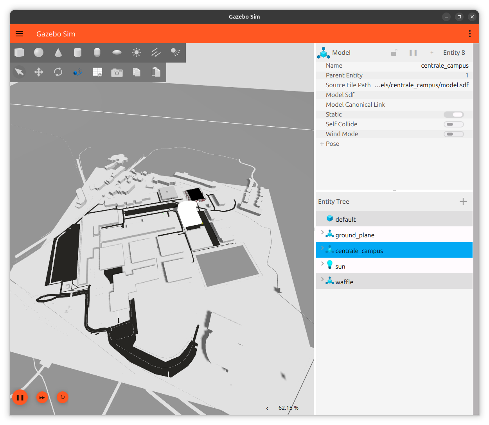
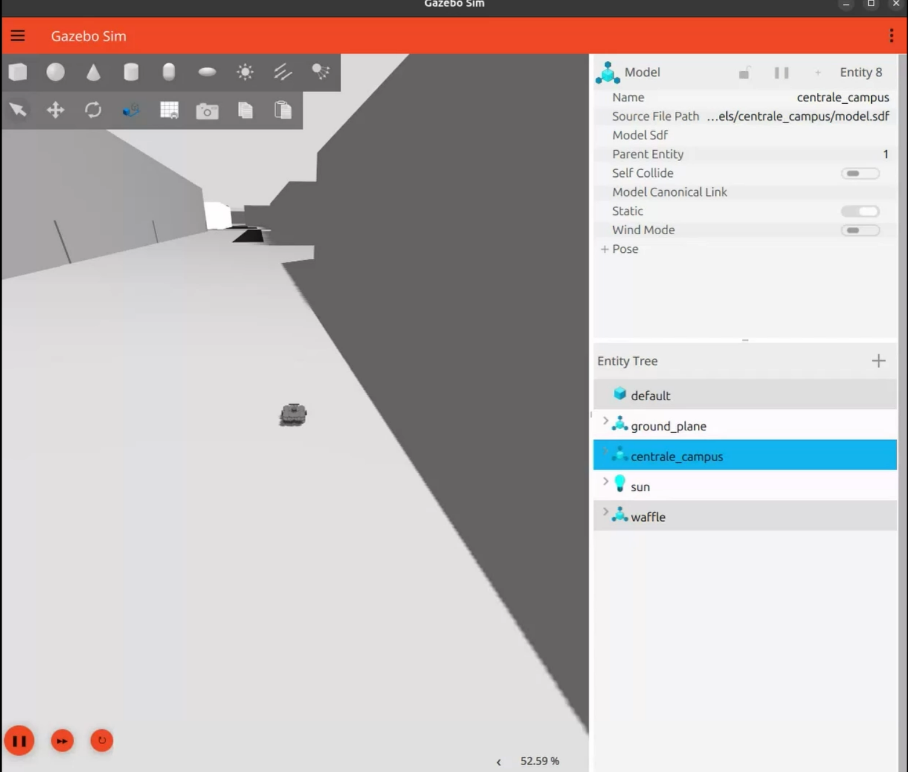

# Centrale Nantes Campus – 3D Digital Twin for Gazebo (ROS 2)

A 3D model of the École Centrale de Nantes campus, built in Blender and loaded into **Gazebo** with **ROS 2**, so a mobile robot (TurtleBot3) can drive around it. The goal is a lightweight simulation environment for testing autonomous navigation on a real campus layout.

M1 Advanced Robotics project, École Centrale de Nantes, 2026. Supervisor: Elwan Héry.
Team: **Sriram Pandian**, Alap Sherry Suresh, Vishal Chandar Suresh.

<!-- Drag your demo video (MP4, under 10 MB) into this README on github.com and it will appear here. -->
**Demo:** TurtleBot3 driving through the campus in Gazebo.



## What I did

- **3D-modelled all the campus buildings in Blender**, starting from the 2D CAD map of the campus and estimating building heights from satellite imagery.
- After the course, **integrated the model into Gazebo Sim (Jetty) and ROS 2 (Lyrical)**: wrote the Gazebo model, world and launch files, spawned a TurtleBot3, and wrote a WASD teleop node to drive it.

## Approach

The team compared three ways to build the campus in 3D:

| Approach | How | Result |
| --- | --- | --- |
| 1. Manual modelling | 2D CAD footprints + heights estimated from satellite imagery, modelled in Blender | Accurate footprints, slow, heights approximate |
| 2. gazebo_terrain_generator | Terrain and building extrusions generated from map data | Good terrain, limited building detail |
| 3. OSM2World | OpenStreetMap data converted to 3D (buildings, roads, vegetation) | Most complete and consistent |

The final model combines them: accurate footprints from the CAD map, roads and context from OpenStreetMap / OSM2World, and heights checked against satellite imagery.

## Repository structure

```
models/centrale_campus/   # Gazebo model: model.config, model.sdf, meshes/campus.dae
worlds/campus.sdf         # Gazebo world: physics, sun, ground plane, campus
launch/campus.launch.py   # Starts Gazebo, loads the campus and spawns a TurtleBot3
scripts/wasd_teleop.py    # Drive the robot with WASD or the arrow keys
blender/                  # Blender source files
media/                    # Screenshots and renders
```

## How to run

Tested on Ubuntu 26.04 with ROS 2 Lyrical and Gazebo Sim 10 (Jetty).

```bash
sudo apt install ros-lyrical-ros-gz ros-lyrical-turtlebot3-gazebo
export TURTLEBOT3_MODEL=waffle

git clone https://github.com/SriGsr/centrale-campus-gazebo.git
cd centrale-campus-gazebo
ros2 launch launch/campus.launch.py      # campus + TurtleBot3
python3 scripts/wasd_teleop.py           # in a second terminal: drive with WASD
```

The robot spawns on a path between buildings (x = -48.5, y = 6.0). Use `x_pose:=` and `y_pose:=` to choose another spot.

## Known limitations and next steps

- The full campus mesh is used for collisions, which slows the simulation (about 50–60 % real time). A simplified collision mesh would fix this.
- Textures are not exported yet, so buildings appear grey.
- Next: add navigation with Nav2 and SLAM, and dynamic elements (cars, pedestrians).

## Credits

Map data © [OpenStreetMap](https://www.openstreetmap.org/copyright) contributors (ODbL). 3D conversion with [OSM2World](https://osm2world.org). Robot model: [TurtleBot3](https://github.com/ROBOTIS-GIT/turtlebot3_simulations) by ROBOTIS.
